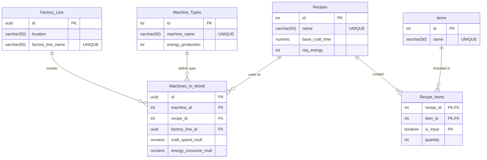
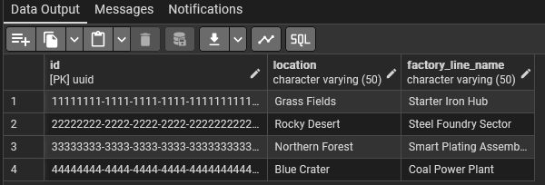
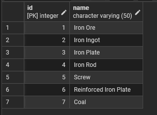
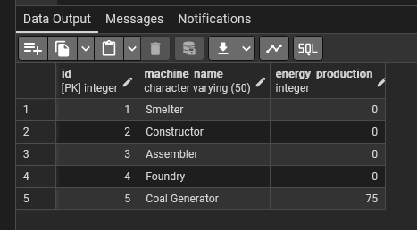
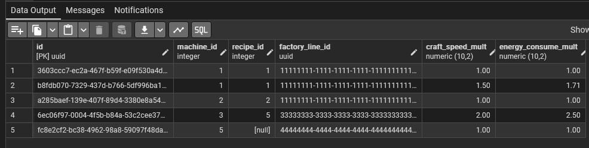
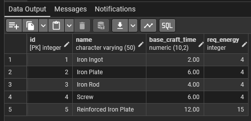
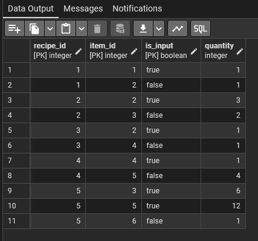

# Лабораторна робота №2: Перетворення ER-діаграми на схему PostgreSQL

**Тема проєкту:** Система управління логістикою та виробничими лініями заводу (за мотивами гри *Satisfactory*)

**Виконав:** Гавязь Максим ІМ-53

---

## 1. Опис реляційної схеми та обмежень цілісності

На основі концептуальної ER-діаграми, розробленої в Лабораторній роботі №1, було спроєктовано фізичну реляційну схему бази даних у СУБД PostgreSQL, що складається з 6 пов'язаних таблиць.

### Візуалізація реляційної схеми



### Детальний опис таблиць, ключів та обмежень

1. **`factory_line` (Виробничі лінії)**
   * `id` (`UUID`, `PRIMARY KEY`, `DEFAULT gen_random_uuid()`) — унікальний ідентифікатор виробничої лінії.
   * `location` (`VARCHAR(50)`, `NOT NULL`) — назва ігрового біому або зони розташування.
   * `factory_line_name` (`VARCHAR(50)`, `NOT NULL`, `UNIQUE`) — унікальна назва виробничої лінії.

2. **`machine_types` (Типи обладнання)**
   * `id` (`SERIAL`, `PRIMARY KEY`) — автоінкрементний ідентифікатор типу будівлі.
   * `machine_name` (`VARCHAR(50)`, `NOT NULL`, `UNIQUE`) — унікальна назва типу обладнання.
   * `energy_production` (`INTEGER`, `NOT NULL`, `DEFAULT 0`, `CHECK (energy_production >= 0)`) — обсяг генерації енергії у МВт (для споживачів дорівнює `0`, не може бути від'ємним).

3. **`recipes` (Рецепти крафту)**
   * `id` (`SERIAL`, `PRIMARY KEY`) — автоінкрементний ідентифікатор рецепта.
   * `name` (`VARCHAR(50)`, `NOT NULL`, `UNIQUE`) — унікальна назва рецепта.
   * `base_craft_time` (`NUMERIC(10, 2)`, `NOT NULL`, `CHECK (base_craft_time > 0)`) — базовий час одного циклу виробництва в секундах (строго додатне значення).
   * `req_energy` (`INTEGER`, `NOT NULL`, `DEFAULT 0`, `CHECK (req_energy >= 0)`) — базове енергоспоживання рецепта у МВт.

4. **`items` (Предмети та ресурси)**
   * `id` (`SERIAL`, `PRIMARY KEY`) — автоінкрементний ідентифікатор предмета.
   * `name` (`VARCHAR(50)`, `NOT NULL`, `UNIQUE`) — унікальна назва ресурсу або компонента.

5. **`machines_in_world` (Екземпляри машин у світі)**
   * `id` (`UUID`, `PRIMARY KEY`, `DEFAULT gen_random_uuid()`) — унікальний ідентифікатор побудованої машини.
   * `machine_id` (`INTEGER`, `NOT NULL`, `FOREIGN KEY`) — посилання на `machine_types(id)` з політикою `ON DELETE RESTRICT` (забороняє видалення типу машини, якщо такі будівлі вже побудовані).
   * `recipe_id` (`INTEGER`, `NULL`, `FOREIGN KEY`) — посилання на `recipes(id)` з політикою `ON DELETE SET NULL`. Допускає `NULL` для електрогенераторів або незапущених верстаків.
   * `factory_line_id` (`UUID`, `NOT NULL`, `FOREIGN KEY`) — посилання на `factory_line(id)` з політикою `ON DELETE CASCADE` (при видаленні виробничої лінії автоматично видаляються всі закріплені за нею машини).
   * `craft_speed_mult` (`NUMERIC(10, 2)`, `NOT NULL`, `DEFAULT 1.00`, `CHECK (craft_speed_mult >= 0.01 AND craft_speed_mult <= 2.50)`) — множник швидкості роботи, обмежений ігровим діапазоном розгону від $1\%$ до $250\%$.
   * `energy_consume_mult` (`NUMERIC(10, 2)`, `NOT NULL`, `DEFAULT 1.00`, `CHECK (energy_consume_mult > 0)`) — множник споживання електроенергії (строго більше нуля).

6. **`recipe_items` (Склад рецептів — зв'язок $M:N$)**
   * `recipe_id` (`INTEGER`, `NOT NULL`, `FOREIGN KEY`) — посилання на `recipes(id)` з політикою `ON DELETE CASCADE`.
   * `item_id` (`INTEGER`, `NOT NULL`, `FOREIGN KEY`) — посилання на `items(id)` з політикою `ON DELETE RESTRICT` (захищає предмети від видалення, поки вони використовуються в рецептах).
   * `is_input` (`BOOLEAN`, `NOT NULL`, `DEFAULT TRUE`) — визначає напрямок руху ресурсу (`TRUE` — вхідна сировина, `FALSE` — вихідний продукт).
   * `quantity` (`INTEGER`, `NOT NULL`, `CHECK (quantity > 0)`) — кількість одиниць предмета за один цикл крафту (рідини та гази враховуються у масштабованих цілих одиницях — мілікубометрах).
   * **Складений первинний ключ:** `PRIMARY KEY (recipe_id, item_id, is_input)` — гарантує унікальність компонента в межах однієї сторони рецепта та дозволяє реалізовувати замкнені цикли (коли один предмет є одночасно і входом, і виходом).

---

## 2. SQL DDL-скрипт створення таблиць (`CREATE TABLE`)

Таблиці створюються у порядку залежностей: спочатку батьківські таблиці-довідники, потім дочірні таблиці із зовнішніми ключами.

```sql

CREATE TABLE factory_line (
    id UUID PRIMARY KEY DEFAULT gen_random_uuid(),
    location VARCHAR(50) NOT NULL,
    factory_line_name VARCHAR(50) NOT NULL UNIQUE
);

CREATE TABLE machine_types (
    id SERIAL PRIMARY KEY,
    machine_name VARCHAR(50) NOT NULL UNIQUE,
    energy_production INTEGER NOT NULL DEFAULT 0 CHECK (energy_production >= 0)
);

CREATE TABLE recipes (
    id SERIAL PRIMARY KEY,
    name VARCHAR(50) NOT NULL UNIQUE,
    base_craft_time NUMERIC(10, 2) NOT NULL CHECK (base_craft_time > 0),
    req_energy INTEGER NOT NULL DEFAULT 0 CHECK (req_energy >= 0)
);

CREATE TABLE items (
    id SERIAL PRIMARY KEY,
    name VARCHAR(50) NOT NULL UNIQUE
);

CREATE TABLE machines_in_world (
    id UUID PRIMARY KEY DEFAULT gen_random_uuid(),
    machine_id INTEGER NOT NULL REFERENCES machine_types(id) ON DELETE RESTRICT,
    recipe_id INTEGER REFERENCES recipes(id) ON DELETE SET NULL,
    factory_line_id UUID NOT NULL REFERENCES factory_line(id) ON DELETE CASCADE,
    craft_speed_mult NUMERIC(10, 2) NOT NULL DEFAULT 1.00 
        CHECK (craft_speed_mult >= 0.01 AND craft_speed_mult <= 2.50),
    energy_consume_mult NUMERIC(10, 2) NOT NULL DEFAULT 1.00 
        CHECK (energy_consume_mult > 0)
);

CREATE TABLE recipe_items (
    recipe_id INTEGER NOT NULL REFERENCES recipes(id) ON DELETE CASCADE,
    item_id INTEGER NOT NULL REFERENCES items(id) ON DELETE RESTRICT,
    is_input BOOLEAN NOT NULL DEFAULT TRUE,
    quantity INTEGER NOT NULL CHECK (quantity > 0),
    PRIMARY KEY (recipe_id, item_id, is_input)
);
```

---

## 3. SQL DML-скрипт наповнення тестовими даними (`INSERT INTO`)

Для перевірки цілісності зв'язків та обмежень у кожну таблицю вставлено від 4 до 11 змістовних записів, що відображають базовий ланцюжок виробництва укріплених залізних пластин (*Reinforced Iron Plate*) та вугільної електростанції.

```sql
INSERT INTO factory_line (id, location, factory_line_name) VALUES
    ('11111111-1111-1111-1111-111111111111', 'Grass Fields', 'Starter Iron Hub'),
    ('22222222-2222-2222-2222-222222222222', 'Rocky Desert', 'Steel Foundry Sector'),
    ('33333333-3333-3333-3333-333333333333', 'Northern Forest', 'Smart Plating Assembly'),
    ('44444444-4444-4444-4444-444444444444', 'Blue Crater', 'Coal Power Plant');

INSERT INTO machine_types (id, machine_name, energy_production) VALUES
    (1, 'Smelter', 0),
    (2, 'Constructor', 0),
    (3, 'Assembler', 0),
    (4, 'Foundry', 0),
    (5, 'Coal Generator', 75);

INSERT INTO items (id, name) VALUES
    (1, 'Iron Ore'),
    (2, 'Iron Ingot'),
    (3, 'Iron Plate'),
    (4, 'Iron Rod'),
    (5, 'Screw'),
    (6, 'Reinforced Iron Plate'),
    (7, 'Coal');

INSERT INTO recipes (id, name, base_craft_time, req_energy) VALUES
    (1, 'Iron Ingot', 2.00, 4),
    (2, 'Iron Plate', 6.00, 4),
    (3, 'Iron Rod', 4.00, 4),
    (4, 'Screw', 6.00, 4),
    (5, 'Reinforced Iron Plate', 12.00, 15);

INSERT INTO recipe_items (recipe_id, item_id, is_input, quantity) VALUES
    -- 1 Iron Ore -> 1 Iron Ingot
    (1, 1, TRUE, 1),
    (1, 2, FALSE, 1),
    -- 3 Iron Ingot -> 2 Iron Plate
    (2, 2, TRUE, 3),
    (2, 3, FALSE, 2),
    -- 1 Iron Ingot -> 1 Iron Rod
    (3, 2, TRUE, 1),
    (3, 4, FALSE, 1),
    -- 1 Iron Rod -> 4 Screw
    (4, 4, TRUE, 1),
    (4, 5, FALSE, 4),
    -- 6 Iron Plate + 12 Screw -> 1 Reinforced Iron Plate
    (5, 3, TRUE, 6),
    (5, 5, TRUE, 12),
    (5, 6, FALSE, 1);

INSERT INTO machines_in_world (machine_id, recipe_id, factory_line_id, craft_speed_mult, energy_consume_mult) VALUES
    (1, 1, '11111111-1111-1111-1111-111111111111', 1.00, 1.00),
    (1, 1, '11111111-1111-1111-1111-111111111111', 1.50, 1.71),
    (2, 2, '11111111-1111-1111-1111-111111111111', 1.00, 1.00),
    (3, 5, '33333333-3333-3333-3333-333333333333', 2.00, 2.50),
    (5, NULL, '44444444-4444-4444-4444-444444444444', 1.00, 1.00);
```

---

## 4. Перевірка та підтвердження наповнення бази даних

Усі DDL та DML скрипти було виконано в середовищі PostgreSQL 17.5 (розгорнутому через Docker Compose) за допомогою **pgAdmin 4** без помилок та порушень обмежень цілісності.

### Перевірочні SQL-запити

```sql
SELECT * FROM factory_line;
SELECT * FROM items;
SELECT * FROM machine_types;
SELECT * FROM machines_in_world;
SELECT * FROM recipes;
SELECT * FROM recipe_items;
```

### Таблиця `factory_line`


### Таблиця `items`


### Таблиця `machine_types`


### Таблиця `machines_in_world`


### Таблиця `recipes`


### Таблиця `recipe_items`
